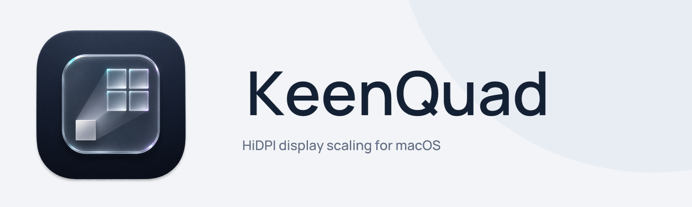
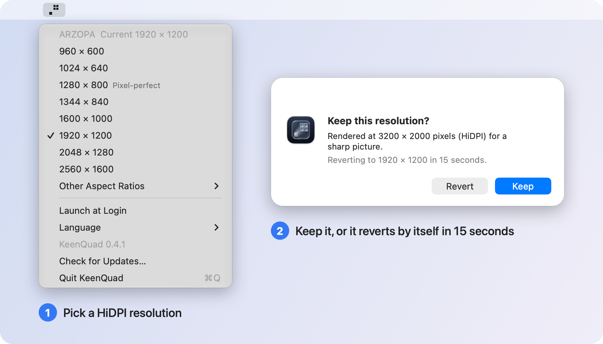
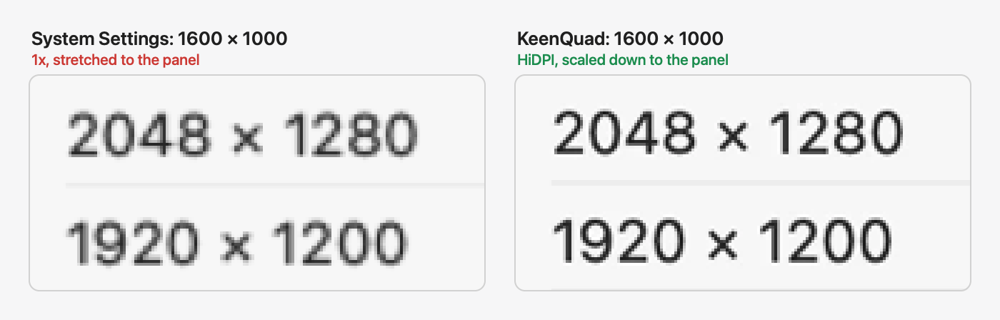

<p align="center">

</p>
<h3 align="center">Sharp HiDPI resolutions for your Mac's display, one click from the menu bar</h3>
<p align="center">
<a href="https://github.com/33to9/KeenQuad/releases/latest"></a> <a href="https://github.com/33to9/KeenQuad/releases"></a> <a href="https://github.com/33to9/KeenQuad/releases/latest"></a> <a href="https://github.com/33to9/KeenQuad/blob/main/LICENSE"></a>
</p>
<p align="center">
<b>English</b> · <a href="docs/README.zh-Hans.md">简体中文</a> · <a href="docs/README.zh-Hant.md">繁體中文</a> · <a href="docs/README.ja.md">日本語</a> · <a href="docs/README.de.md">Deutsch</a> · <a href="docs/README.ko.md">한국어</a> · <a href="docs/README.fr.md">Français</a> · <a href="docs/README.es.md">Español</a>
</p>

> **KeenQuad** is a tiny menu-bar app that switches your display between HiDPI resolutions, including the sharp ones that System Settings doesn't show.
> On many external displays, a resolution like 1600 × 1000 appears in System Settings only in its 1x version, which looks blurry. macOS also has a HiDPI version of it that looks crisp, but only apps that read the full display mode table can switch to it. KeenQuad does exactly that, and nothing more.

<p align="center"></p>

## Why the same resolution can look blurry or sharp

Each size usually exists twice in macOS's display mode table. On a 2560 × 1600 panel, for 1600 × 1000:

| Version | How macOS draws it | Looks |
|---|---|---|
| 1x | Renders 1600 × 1000 pixels, then stretches them up to the panel | Blurry |
| HiDPI | Renders 3200 × 2000 pixels, then scales them down to the panel | Sharp |

<p align="center"></p>
<p align="center"><sub>The same two rows of System Settings as a 2560 × 1600 panel shows them, simulated from screenshots and magnified 4×.</sub></p>

System Settings › Displays only lists modes from the public API, which hides many HiDPI versions. When you pick 1600 × 1000 there, you get the 1x one. When the current mode is a HiDPI one set by KeenQuad, System Settings shows the same name as selected; clicking it again switches you to the blurry version.

To check what you're using, run `system_profiler SPDisplaysDataType`: in HiDPI, **Resolution** is twice **UI Looks like**.

## Features

- Lists every HiDPI resolution of each display, including the hidden ones, and marks the current one and the panel's pixel-perfect size
- One click to switch. If you don't confirm a new resolution within 15 seconds, it switches back by itself, so a black screen fixes itself
- If you're on a blurry 1x resolution, the menu offers **Switch to Sharp** for the same size, with the same desktop size
- Resolutions you keep stay after quitting, logging out and restarting; macOS saves them, so nothing runs in the background
- Launch at login, and **Check for Updates…**
- English, 简体中文, 繁體中文, 日本語, Deutsch, 한국어, Français and Español; follows your system language, or pick one in the menu

## System Requirements

- A Mac with Apple silicon
- macOS 14 and later

## Install

### Option 1: one-line install (recommended, no Gatekeeper warning)

Open Terminal, paste this and press Return:

```bash
curl -fsSL https://raw.githubusercontent.com/33to9/KeenQuad/main/install.sh | bash
```

The script downloads the latest release from GitHub, verifies its SHA-256, installs it to Applications and opens it. Files downloaded with curl carry no quarantine flag, so macOS doesn't block the first launch. If KeenQuad is already installed, it's updated in place and keeps its Launch at Login setting. The script is short — feel free to [read it](install.sh) first.

### Option 2: DMG

**[Download KeenQuad.dmg](https://github.com/33to9/KeenQuad/releases/latest/download/KeenQuad.dmg)** (always the latest version), open it and drag KeenQuad onto the Applications folder. Older versions are on [Releases](../../releases).

The app is not notarized by Apple, so macOS blocks the first launch once:
- **macOS 15 and later**: double-click (a warning appears), then open **System Settings → Privacy & Security**, scroll down and click **Open Anyway**
- **macOS 14**: right-click the app → **Open**

### Updating

Choose **Check for Updates…** in KeenQuad's menu. If there's a new version, it shows what's new and opens the download page. To update without the Gatekeeper warning, run the one-line installer again.

## Using KeenQuad

Click the KeenQuad icon in the menu bar:

- Click a resolution to switch. A new resolution asks **Keep this resolution?**; press Return to keep it, Esc to revert, or wait 15 seconds and it reverts by itself. Resolutions you kept before switch straight away.
- **Switch to Sharp** appears when the current resolution is a blurry 1x one with a HiDPI version.
- **Other Aspect Ratios** lists HiDPI sizes whose shape doesn't match the panel.
- **Language** and **Launch at Login** are at the bottom of the menu.

## Permissions

None. Switching display modes doesn't need Screen Recording, Accessibility or any other permission. If macOS asks you to approve the login item, KeenQuad opens the right page in System Settings.

## Privacy

KeenQuad collects nothing and has no telemetry. It connects to the internet only when you click **Check for Updates…**: one request to the GitHub API for the latest release, carrying no information about you. Your settings stay in `~/Library/Preferences/com.pivotfrag.keenquad.plist`.

## Uninstall

1. In KeenQuad's menu, turn off **Launch at Login**, then choose **Quit KeenQuad**.
2. Delete `/Applications/KeenQuad.app`.
3. Optional: run `defaults delete com.pivotfrag.keenquad`.

The resolution you're using stays; change it in System Settings if you like.

## How it works

KeenQuad reads and switches the display mode table through private CoreGraphics functions (`CGSGetNumberOfDisplayModes`, `CGSGetDisplayModeDescriptionOfLength`, `CGSConfigureDisplayMode`), the same ones the open-source `displayplacer` uses. It doesn't create resolutions, install display overrides or ask for an administrator password; it only switches to modes macOS already has. A new resolution is first applied for the app only, so if KeenQuad is force-quit, macOS reverts it; it's saved permanently only when you keep it.

Because it uses private functions, a future macOS update could change them. If the menu ever comes up empty, please [open an issue](../../issues).

## Building from source

Requirements: Xcode Command Line Tools (Xcode isn't needed).

```bash
git clone https://github.com/33to9/KeenQuad.git
cd KeenQuad/tray
./build.sh --install        # build and install to /Applications
./Tests/run-selftest.sh     # read-only rule tests, switches nothing
```

`./build.sh --package` creates `dist/KeenQuad_vX.Y.Z.dmg` and `dist/KeenQuad_vX.Y.Z_macOS.zip` for a release. Developer notes are in [`tray/README.md`](tray/README.md).

## License

This project is licensed under **GPL-3.0-only** (see [LICENSE](LICENSE)). The KeenQuad name and icons are not covered by the license; see [TRADEMARK.md](TRADEMARK.md).

Copyright © 2026 [Pivotfrag LLC](https://pivotfrag.com)
