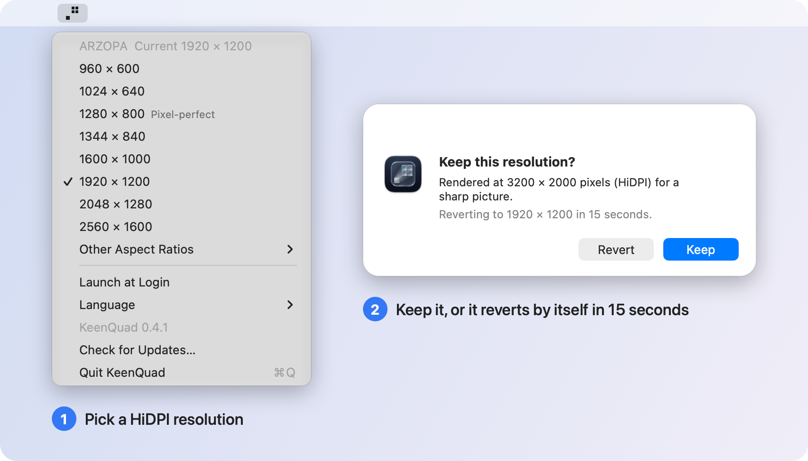
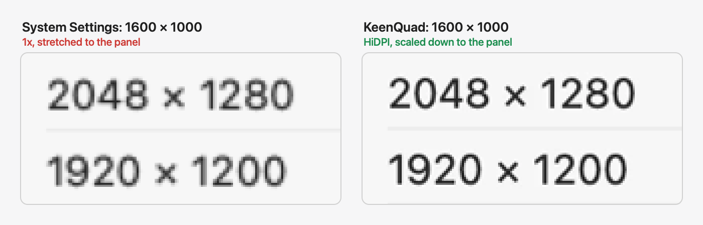

<p align="center">

</p>
<h3 align="center">메뉴 막대에서 클릭 한 번으로 디스플레이의 선명한 HiDPI 해상도로</h3>
<p align="center">
<a href="https://github.com/33to9/KeenQuad/releases/latest"></a> <a href="https://github.com/33to9/KeenQuad/releases"></a> <a href="https://github.com/33to9/KeenQuad/releases/latest"></a> <a href="https://github.com/33to9/KeenQuad/blob/main/LICENSE"></a>
</p>
<p align="center">
<a href="../README.md">English</a> · <a href="README.zh-Hans.md">简体中文</a> · <a href="README.zh-Hant.md">繁體中文</a> · <a href="README.ja.md">日本語</a> · <a href="README.de.md">Deutsch</a> · <b>한국어</b> · <a href="README.fr.md">Français</a> · <a href="README.es.md">Español</a>
</p>

> **KeenQuad**는 디스플레이의 HiDPI 해상도를 전환하는 작은 메뉴 막대 앱입니다. ‘시스템 설정’에 나타나지 않는 선명한 해상도로도 전환할 수 있습니다.
> 많은 외장 디스플레이에서 1600 × 1000 같은 해상도는 ‘시스템 설정’에 1배 버전만 있어 흐릿하게 보입니다. macOS에는 선명하게 보이는 HiDPI 버전도 있지만, 전체 디스플레이 모드 목록을 읽는 앱만 그 버전으로 전환할 수 있습니다. KeenQuad는 딱 그 일만 합니다.

<p align="center"></p>

## 같은 해상도가 흐릿하기도, 선명하기도 한 이유

macOS의 디스플레이 모드 목록에는 같은 크기가 보통 두 번 있습니다. 2560 × 1600 패널에서 1600 × 1000을 예로 들면:

| 버전 | macOS가 그리는 방식 | 보이는 모습 |
|---|---|---|
| 1배 | 1600 × 1000 픽셀로 렌더링한 뒤 패널에 맞춰 늘림 | 흐릿함 |
| HiDPI | 3200 × 2000 픽셀로 렌더링한 뒤 패널에 맞춰 줄임 | 선명함 |

<p align="center"></p>
<p align="center"><sub>시스템 설정의 같은 두 줄이 2560 × 1600 패널에서 보이는 모습을 스크린샷으로 재현해 4배 확대했습니다.</sub></p>

‘시스템 설정 › 디스플레이’는 공개 API가 제공하는 모드만 보여 주는데, 공개 API는 많은 HiDPI 버전을 숨깁니다. 거기서 1600 × 1000을 고르면 1배 버전이 됩니다. KeenQuad로 설정한 HiDPI 해상도를 쓰는 중이면 ‘시스템 설정’은 이름이 같은 항목을 선택된 것으로 표시하고, 그 항목을 다시 클릭하면 흐릿한 버전으로 바뀝니다.

지금 어느 쪽을 쓰고 있는지는 `system_profiler SPDisplaysDataType`으로 확인할 수 있습니다. HiDPI에서는 **Resolution**이 **UI Looks like**의 두 배입니다.

## 기능

- 각 디스플레이의 모든 HiDPI 해상도를 숨겨진 것까지 보여 주고, 현재 해상도와 패널의 픽셀 일치 크기를 표시
- 클릭 한 번으로 전환. 새 해상도를 15초 안에 확정하지 않으면 저절로 되돌아가므로, 화면이 검게 변해도 스스로 복구됨
- 흐릿한 1배 해상도를 쓰는 중이면 같은 크기의 **선명한 버전으로 전환**이 메뉴에 나타나며, 데스크탑 크기는 그대로
- 유지한 해상도는 종료, 로그아웃, 재시동 후에도 그대로. macOS가 저장하므로 백그라운드에서 실행되는 것은 없음
- 로그인 시 실행, **업데이트 확인…**
- English, 简体中文, 繁體中文, 日本語, Deutsch, 한국어, Français, Español 지원. 시스템 언어를 따르거나 메뉴에서 직접 선택

## 시스템 요구 사항

- Apple 실리콘 Mac
- macOS 14 이상

## 설치

### 방법 1: 한 줄로 설치 (권장, Gatekeeper 경고 없음)

‘터미널’을 열고 다음 줄을 붙여 넣은 다음 Return 키를 누르십시오.

```bash
curl -fsSL https://raw.githubusercontent.com/33to9/KeenQuad/main/install.sh | bash
```

스크립트는 GitHub에서 최신 릴리스를 다운로드하고 SHA-256을 확인한 뒤 ‘응용 프로그램’에 설치하고 실행합니다. curl로 다운로드한 파일에는 격리 표시가 붙지 않으므로 macOS가 처음 실행을 막지 않습니다. KeenQuad가 이미 설치되어 있으면 그 자리에서 업데이트되며 ‘로그인 시 실행’ 설정도 유지됩니다. 스크립트가 짧으니 먼저 [읽어 보셔도](../install.sh) 됩니다.

### 방법 2: DMG

**[KeenQuad.dmg 다운로드](https://github.com/33to9/KeenQuad/releases/latest/download/KeenQuad.dmg)**(항상 최신 버전)한 뒤 열고 KeenQuad를 ‘응용 프로그램’ 폴더로 드래그하십시오. 이전 버전은 [Releases](https://github.com/33to9/KeenQuad/releases)에 있습니다.

이 앱은 Apple의 공증을 받지 않았기 때문에 macOS가 처음 실행을 한 번 막습니다.
- **macOS 15 이상**: 이중 클릭(경고가 나타남)한 다음 **시스템 설정 → 개인정보 보호 및 보안**을 열고, 아래로 스크롤하여 **그래도 열기**를 클릭
- **macOS 14**: 앱을 오른쪽 클릭 → **열기**

### 업데이트

KeenQuad 메뉴에서 **업데이트 확인…**을 선택하십시오. 새 버전이 있으면 변경 사항을 보여 주고 다운로드 페이지를 엽니다. Gatekeeper 경고 없이 업데이트하려면 위의 한 줄 설치를 다시 실행하십시오.

## 사용 방법

메뉴 막대의 KeenQuad 아이콘을 클릭하십시오.

- 해상도를 클릭하면 전환됩니다. 새 해상도에서는 **이 해상도를 유지하겠습니까?**라고 묻습니다. Return 키로 유지, Esc 키로 되돌리기, 15초가 지나면 저절로 되돌아갑니다. 전에 유지한 해상도는 바로 전환됩니다.
- 현재 해상도가 HiDPI 버전이 있는 흐릿한 1배 해상도이면 **선명한 버전으로 전환**이 나타납니다.
- **기타 화면비**에는 패널과 모양이 다른 HiDPI 크기가 있습니다.
- **언어**와 **로그인 시 실행**은 메뉴 아래쪽에 있습니다.

## 권한

필요 없습니다. 디스플레이 모드를 전환하는 데 화면 기록, 손쉬운 사용 같은 권한은 필요하지 않습니다. macOS가 로그인 항목 허용을 요청하면 KeenQuad가 ‘시스템 설정’의 해당 페이지를 엽니다.

## 개인정보 보호

KeenQuad는 아무것도 수집하지 않으며 사용 통계도 없습니다. **업데이트 확인…**을 클릭할 때만 인터넷에 연결하여 최신 릴리스를 확인하기 위해 GitHub API에 요청을 한 번 보내며, 사용자에 관한 정보는 담지 않습니다. 설정은 `~/Library/Preferences/com.pivotfrag.keenquad.plist`에 저장됩니다.

## 제거

1. KeenQuad 메뉴에서 **로그인 시 실행**을 끄고 **KeenQuad 종료**를 선택하십시오.
2. `/Applications/KeenQuad.app`을 삭제하십시오.
3. 선택 사항: `defaults delete com.pivotfrag.keenquad`을 실행하십시오.
4. 0.4.0에서 업데이트한 경우: `defaults delete com.keenquad.app`도 실행하고, **시스템 설정 › 일반 › 로그인 항목**에 남아 있는 KeenQuad 항목이 있으면 제거하십시오.

사용 중인 해상도는 그대로 유지됩니다. 원하면 ‘시스템 설정’에서 바꾸십시오.

## 작동 방식

KeenQuad는 CoreGraphics의 비공개 함수(`CGSGetNumberOfDisplayModes`, `CGSGetDisplayModeDescriptionOfLength`, `CGSConfigureDisplayMode`)로 디스플레이 모드 목록을 읽고 전환합니다. 오픈 소스 도구 `displayplacer`가 쓰는 것과 같은 함수입니다. 해상도를 새로 만들거나 디스플레이 오버라이드를 설치하거나 관리자 암호를 요구하지 않으며, macOS에 이미 있는 모드로 전환할 뿐입니다. 새 해상도는 먼저 이 앱이 실행되는 동안에만 적용되므로 KeenQuad가 강제 종료되면 macOS가 되돌립니다. 유지를 선택해야만 영구적으로 저장됩니다.

비공개 함수를 사용하므로 향후 macOS 업데이트에서 바뀔 수 있습니다. 메뉴가 비어 있다면 [이슈를 등록](https://github.com/33to9/KeenQuad/issues)해 주십시오.

## 소스에서 빌드

필요 사항: Xcode 명령어 라인 도구(Xcode는 필요 없음).

```bash
git clone https://github.com/33to9/KeenQuad.git
cd KeenQuad/tray
./build.sh --install        # 빌드하고 /Applications에 설치
./Tests/run-selftest.sh     # 읽기 전용 규칙 테스트, 해상도를 바꾸지 않음
```

`./build.sh --package`는 릴리스용 `dist/KeenQuad_vX.Y.Z.dmg`와 `dist/KeenQuad_vX.Y.Z_macOS.zip`을 만듭니다. 개발 노트(영어)는 [`tray/README.md`](../tray/README.md)에 있습니다.

## 라이선스

이 프로젝트는 **GPL-3.0-only** 라이선스를 따릅니다([LICENSE](../LICENSE) 참고). KeenQuad 이름과 아이콘은 라이선스 대상이 아닙니다. [TRADEMARK.md](../TRADEMARK.md)를 참고하십시오.

Copyright © 2026 [Pivotfrag LLC](https://pivotfrag.com)
